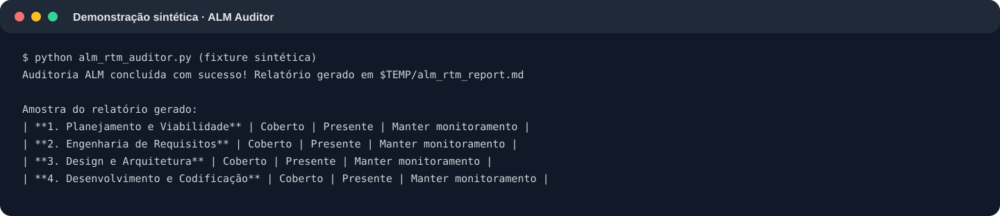

# ALM Governance Tools

[](https://github.com/edsonnascimentoc/Engenharia-de-Software/actions/workflows/alm-ci-quality-gate.yml)
[](https://codecov.io/gh/edsonnascimentoc/Engenharia-de-Software)
[](LICENSE)

Ferramentas para tornar a governança do ciclo de vida de requisitos verificável em
repositórios de software. O projeto automatiza verificações de rastreabilidade ALM,
estrutura documental e qualidade de issues, reduzindo revisões manuais repetitivas.

## Navegação

- [Instalação e uso](#instalação-e-uso)
- [Exemplos](#exemplos)
- [Demonstração](#demonstração)
- [Limitações](#limitações)
- [Documentação de governança](#documentação-de-governança)
- [Contribuição e licença](#contribuição-e-licença)

## Pré-requisitos

- Python 3.12 ou superior
- Node.js 20 ou superior (para o validador de issues)
- Git

## Instalação e uso

Clone o repositório e prepare o ambiente Python:

```bash
git clone https://github.com/edsonnascimentoc/Engenharia-de-Software.git
cd Engenharia-de-Software
python -m venv .venv
```

Ative o ambiente e instale as ferramentas de desenvolvimento:

```powershell
# Windows PowerShell
.\.venv\Scripts\Activate.ps1
python -m pip install -r requirements-dev.txt
```

```bash
# Linux/macOS
source .venv/bin/activate
python -m pip install -r requirements-dev.txt
```

## Exemplos

Audite a matriz de rastreabilidade usando o caminho legado:

```bash
python alm_rtm_auditor.py
```

Valide documentação e links locais, execute a suíte Node e confira estilo Python:

```bash
python -m src.validate_docs
node --test tests/node/*.test.js
python -m ruff check src tests/python
python -m ruff format --check src tests/python
```

O workflow [ALM CI Quality Gate](.github/workflows/alm-ci-quality-gate.yml) executa
testes, lint e validação documental em pushes para `main` e pull requests.

## Demonstração

O projeto é um conjunto de ferramentas de linha de comando e workflows, sem interface
gráfica. A imagem abaixo registra a saída real do auditor executado contra uma fixture
sintética; gere-a novamente com `python scripts/capture_alm_demo.py`.



Consulte também a [execução local documentada](docs/alm/index.md) e o
[registro de evidências e verificação](docs/alm/artefatos/evidencias-verificacao.md).

## Limitações

- A auditoria verifica estrutura e rastreabilidade documental; ela não substitui
  revisão humana sobre correção ou suficiência dos requisitos.
- A validação automatizada de issues é estrutural e não garante qualidade semântica.
- Os badges refletem serviços externos e dependem da disponibilidade e atualização
  desses serviços.
- O badge de cobertura só exibirá um percentual após o Codecov aceitar o primeiro
  relatório desta branch.
- O projeto não publica nem implanta uma aplicação de produto.

## Documentação de governança

- [Índice ALM](docs/alm/index.md)
- [Matriz de rastreabilidade](docs/alm/artefatos/matriz-rastreabilidade.md)
- [Plano de governança](docs/superpowers/plans/2026-11-23-governanca-alm.md)
- [Contribuição e releases](CONTRIBUTING.md)
- [Checklist de release](docs/alm/artefatos/checklist-release.md)
- [Metadados propostos para o GitHub](docs/alm/artefatos/metadados-github.md)
- [Segurança](SECURITY.md)
- [Código de conduta](CODE_OF_CONDUCT.md)

## Componentes

- `src/agents/runner.js`: validador Node.js de issues; `.github/agents/runner.js`
  mantém compatibilidade com o caminho anterior.
- `src/alm_rtm_auditor.py`: auditoria ALM, também acessível por
  `python alm_rtm_auditor.py`.
- `src/validate_docs.py`: implementação oficial da validação de documentação e links
  locais, executada com `python -m src.validate_docs`.
- `scripts/validate_docs.py`: wrapper de compatibilidade que encaminha a execução e
  reexporta a API pública do validador para consumidores que usam o caminho legado.
- `.github/agents/mcp.json` e `.github/agents/prompts/`: configuração e prompts dos
  agentes de issue.
- `.github/workflows/`: quality gate ALM, validação de issues e pipeline de segurança.

Ruff `0.17.6` e Coverage `7.10.6` estão fixados em `requirements-dev.txt`, alinhados
com as ferramentas usadas pela CI. Para executar localmente os mesmos testes Python:

```bash
python -m pip install -r requirements-dev.txt
coverage run --branch -m unittest discover -s tests/python -v
coverage report --show-missing
```

## Contribuição e licença

Leia [CONTRIBUTING.md](CONTRIBUTING.md) antes de abrir uma contribuição. Este projeto
está licenciado sob a [GNU General Public License v3.0](LICENSE).
